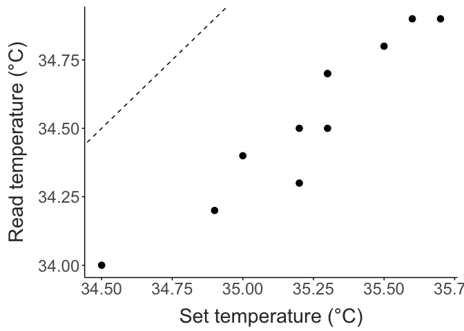
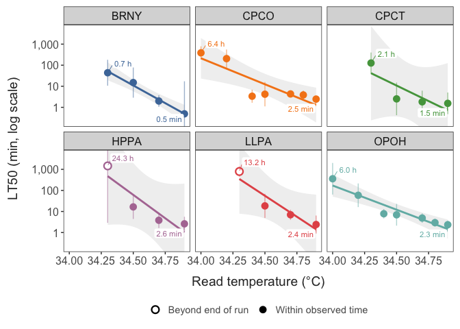
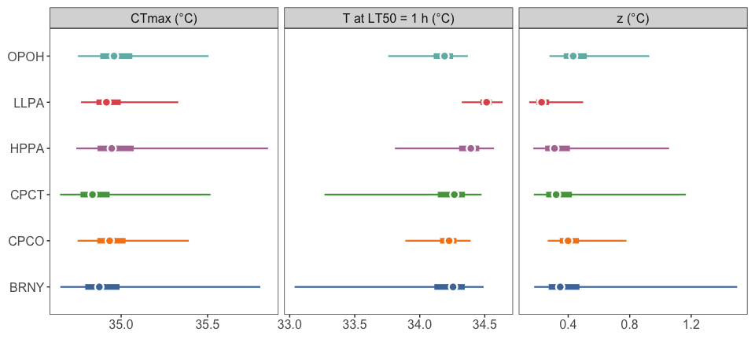
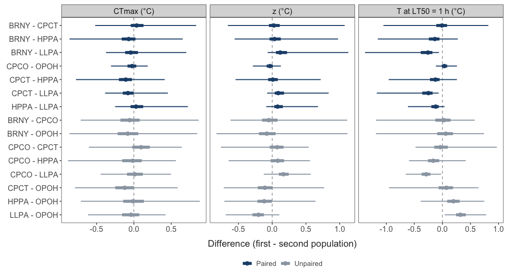
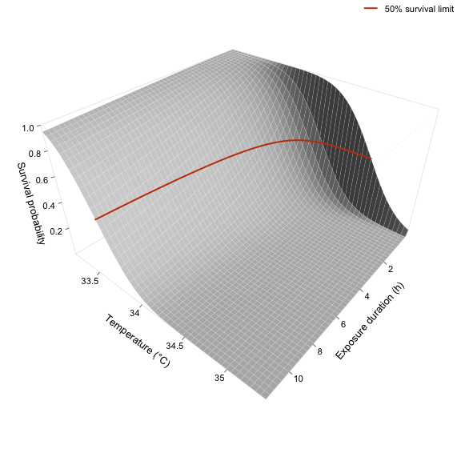
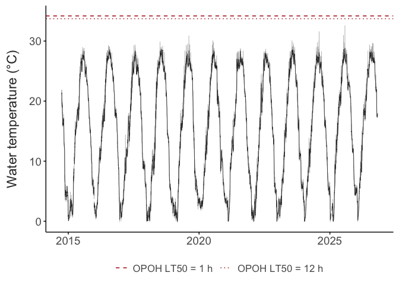
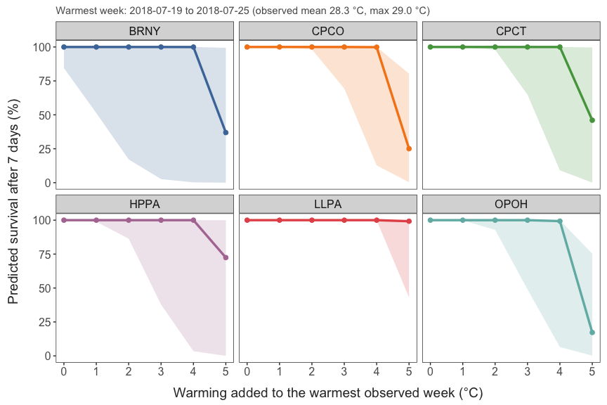
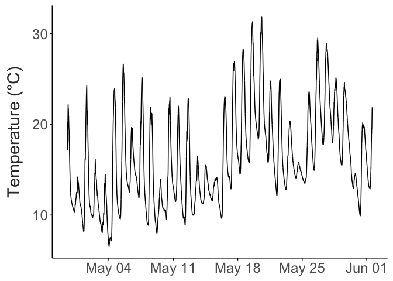
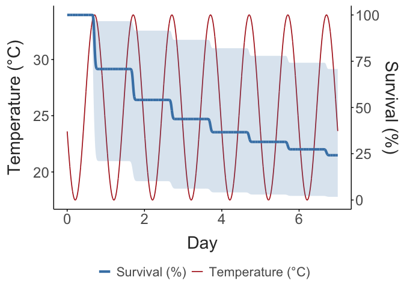

Thermal Tolerance Landscapes of *Skistodiaptomus pallidus*
================
2026-10-29

- [Data overview](#data-overview)
- [Building the survival dataset](#building-the-survival-dataset)
- [Per-run LT50 values](#per-run-lt50-values)
- [Individual-level AFT model](#individual-level-aft-model)
  - [Linearity check](#linearity-check)
- [Tolerance landscape parameters](#tolerance-landscape-parameters)
  - [Population differences](#population-differences)
- [Tolerance landscape
  visualization](#tolerance-landscape-visualization)
- [Mortality under variable
  temperatures](#mortality-under-variable-temperatures)
  - [Example 1: Cheney Reservoir,
    Kansas](#example-1-cheney-reservoir-kansas)
  - [Example 2](#example-2)
- [Session info](#session-info)

``` r
# Reference (centring) temperature for the models. CTmax and z do not depend on
# this choice; it only makes the intercepts interpretable (log survival time at
# temp_center) and reduces the correlation between intercept and slope.
temp_center = 34.5

# Runs observed for less than this many minutes cannot show whether loss of
# movement was final (recoveries in longer runs happened tens of minutes to
# hours after animals stopped moving). They are kept, but flagged.
min_watch_min = 60

pop_colours = c(BRNY = "#4C78A8", CPCO = "#F58518", CPCT = "#54A24B",
                HPPA = "#B279A2", LLPA = "#E45756", OPOH = "#72B7B2")
```

## Data overview

All runs used here follow the current assay protocol (runs on or before
2026-10-08 used an earlier protocol and are excluded in
`00_controller.R`). Animals are added to wells already holding at the
target temperature, background mortality at benign temperatures is zero,
and all cultures have been held in common garden for more than three
generations.

The temperature read in the wells is lower than the bath set point, so
the read temperature (`read_temp_c`) is used throughout.

``` r
raw_data |>
  distinct(run_id, set_temp_c, read_temp_c) |>
  ggplot(aes(x = set_temp_c, y = read_temp_c)) +
  geom_abline(intercept = 0, slope = 1, linetype = "dashed") +
  geom_point(size = 3) +
  labs(x = "Set temperature (°C)", y = "Read temperature (°C)") +
  theme_matt()
```



Each run is one water bath on one day at one temperature, and the run
(not the individual) is the unit of replication for temperature effects.

``` r
run_table = raw_data |>
  group_by(run_id, experiment_date, water_bath_id, read_temp_c) |>
  summarise(populations = paste(sort(unique(population)), collapse = ", "),
            n_animals = n_distinct(paste(population, well_id)),
            watched_min = max(timepoint_min),
            .groups = "drop") |>
  mutate(short_run = watched_min < min_watch_min) |>
  arrange(read_temp_c)

knitr::kable(run_table, caption = "Runs included in the analysis. `short_run` = watched for less than the minimum time needed to confirm that loss of movement was final.")
```

| run_id | experiment_date | water_bath_id | read_temp_c | populations | n_animals | watched_min | short_run |
|:---|:---|:---|---:|:---|---:|---:|:---|
| 2026-10-20_WB-1 | 2026-10-20 | WB-1 | 34.0 | CPCO, OPOH | 20 | 905 | FALSE |
| 2026-10-20_WB-2 | 2026-10-20 | WB-2 | 34.2 | CPCO, OPOH | 20 | 890 | FALSE |
| 2026-10-25_WB-3 | 2026-10-25 | WB-3 | 34.3 | BRNY, CPCT, HPPA, LLPA | 20 | 720 | FALSE |
| 2026-10-09_WB-1 | 2026-10-09 | WB-1 | 34.4 | CPCO, OPOH | 20 | 30 | TRUE |
| 2026-10-11_WB-2 | 2026-10-11 | WB-2 | 34.5 | CPCO, OPOH | 20 | 722 | FALSE |
| 2026-10-22_WB-2 | 2026-10-22 | WB-2 | 34.5 | BRNY, CPCT, HPPA, LLPA | 20 | 360 | FALSE |
| 2026-10-13_WB-1 | 2026-10-13 | WB-1 | 34.7 | CPCO, OPOH | 20 | 30 | TRUE |
| 2026-10-25_WB-1 | 2026-10-25 | WB-1 | 34.7 | BRNY, CPCT, HPPA, LLPA | 20 | 15 | TRUE |
| 2026-10-20_WB-3 | 2026-10-20 | WB-3 | 34.8 | CPCO, OPOH | 20 | 30 | TRUE |
| 2026-10-13_WB-3 | 2026-10-13 | WB-3 | 34.9 | CPCO, OPOH | 20 | 5 | TRUE |
| 2026-10-22_WB-3 | 2026-10-22 | WB-3 | 34.9 | BRNY, CPCT, HPPA, LLPA | 20 | 48 | TRUE |

Runs included in the analysis. `short_run` = watched for less than the
minimum time needed to confirm that loss of movement was final.

## Building the survival dataset

**Endpoint: final loss of movement.** Some animals stop responding and
later recover, so the first non-responding check is not treated as
death. For each individual:

- *Died* if it was not responding at the last check. Death occurred
  after the last check at which it was responding (`lower`) and at or
  before the next check (`upper`): an **interval-censored** time.
  Animals never seen responding have `lower = 0` (left-censored).
- *Survived* (right-censored at the end of the run) if it was responding
  at the last check.

Individuals that were already not responding at a 0-min check and never
responded afterwards are excluded as dead before exposure. Rows flagged
in the logger (`flagged == "yes"`) are mostly animals that recovered
after a period of non-response; they are kept, because the endpoint
definition above already handles recovery.

``` r
surv_data = raw_data |>
  arrange(run_id, well_id, timepoint_min) |>
  group_by(run_id, source_file, experiment_date, water_bath_id, read_temp_c, well_id, population) |>
  summarise(
    dead_at_start = !any(responding == "yes") & min(timepoint_min) == 0,
    final_no      = last(responding) == "no",
    last_yes      = if (any(responding == "yes")) max(timepoint_min[responding == "yes"]) else 0,
    upper         = if (final_no) min(timepoint_min[timepoint_min > last_yes]) else NA_real_,
    recovered     = any(responding == "no" & timepoint_min < last_yes),
    flagged       = any(flagged == "yes", na.rm = TRUE),
    watched_min   = max(timepoint_min),
    .groups = "drop") |>
  filter(!dead_at_start) |>
  mutate(
    event   = as.integer(final_no),
    lower   = if_else(final_no, last_yes, watched_min),   # 0 = left-censored
    # survreg coding (interval2): NA lower = left-censored, NA upper = right-censored
    sr_lower = if_else(lower == 0, NA_real_, lower),
    # brms coding
    cens = case_when(!final_no ~ "right", lower == 0 ~ "left", TRUE ~ "interval"),
    y    = if_else(cens == "left", upper, lower),
    y2   = if_else(cens == "interval", upper, NA_real_),
    temp_c = read_temp_c - temp_center,
    population = factor(population),
    run_id = factor(run_id))

surv_data |>
  summarise(individuals = n(), died = sum(event), right_censored = sum(cens == "right"),
            left_censored = sum(cens == "left"), recovered_after_non_response = sum(recovered),
            flagged = sum(flagged)) |>
  knitr::kable()
```

| individuals | died | right_censored | left_censored | recovered_after_non_response | flagged |
|---:|---:|---:|---:|---:|---:|
| 218 | 209 | 9 | 24 | 41 | 39 |

## Per-run LT50 values

As a transparent view of the data, the LT50 of each population in each
run is estimated from an intercept-only interval-censored AFT model
(log-normal, matching the main model below), and log10(LT50) is
regressed on temperature for each population, as in Rezende et
al. (2020). This figure is descriptive: the parameter estimates come
from the individual-level model in the next section.

``` r
lt50_runs = surv_data |>
  group_by(population, run_id, read_temp_c) |>
  group_modify(\(d, k) {
    m = survreg(Surv(sr_lower, upper, type = "interval2") ~ 1, data = d, dist = "lognormal")
    tibble(n = nrow(d),
           n_died = sum(d$event),
           log_lt50 = unname(coef(m)[1]),
           se_log = sqrt(vcov(m)[1, 1]),
           watched_min = max(d$watched_min))
  }) |>
  ungroup() |>
  mutate(lt50 = exp(log_lt50),
         lwr = exp(log_lt50 - 1.96 * se_log),
         upr = exp(log_lt50 + 1.96 * se_log),
         # LT50 beyond the end of the run is an extrapolation along the fitted curve
         basis = if_else(lt50 > watched_min, "Beyond end of run", "Within observed time"))

lt50_fits = lt50_runs |>
  group_by(population) |>
  group_modify(\(d, k) {
    m = lm(log10(lt50) ~ read_temp_c, data = d)
    tibble(n_runs = nrow(d),
           ctmax = -coef(m)[[1]] / coef(m)[[2]],
           z = -1 / coef(m)[[2]],
           r2 = summary(m)$r.squared)
  }) |>
  ungroup()

# Label the shortest LT50 (in minutes) and the longest LT50 (in hours) in each panel
lt50_extremes = lt50_runs |>
  group_by(population) |>
  filter(lt50 == min(lt50) | lt50 == max(lt50)) |>
  mutate(which = if_else(lt50 == min(lt50), "shortest", "longest"),
         label = if_else(which == "shortest",
                         sprintf("%.1f min", lt50),
                         sprintf("%.1f h", lt50 / 60)),
         # shortest LT50s sit at the hot (right) end, so push their labels down-left; longest up-right
         nudge_x = if_else(which == "shortest", -0.12, 0.12),
         nudge_y = if_else(which == "shortest", -0.45, 0.45)) |>
  ungroup()

ggplot(lt50_runs, aes(x = read_temp_c, y = lt50, colour = population)) +
  facet_wrap(~ population) +
  geom_smooth(method = "lm", formula = y ~ x, se = TRUE, alpha = 0.15, linewidth = 1) +
  geom_errorbar(aes(ymin = lwr, ymax = upr), width = 0, alpha = 0.5) +
  geom_point(aes(shape = basis), size = 3, fill = "white", stroke = 1.2) +
  ggrepel::geom_label_repel(data = lt50_extremes, aes(label = label),
                            nudge_x = lt50_extremes$nudge_x, nudge_y = lt50_extremes$nudge_y,
                            size = 3, fill = "white", label.size = 0, label.padding = 0.15,
                            min.segment.length = 0, segment.size = 0.3, seed = 42,
                            show.legend = FALSE) +
  scale_y_log10(labels = scales::label_comma(), breaks = 10^(-1:4)) +
  coord_cartesian(ylim = c(0.2, 5000)) +   # keeps wide regression ribbons from stretching the axis
  scale_shape_manual(values = c("Within observed time" = 16, "Beyond end of run" = 21), name = NULL) +
  scale_colour_manual(values = pop_colours, guide = "none") +
  labs(x = "Read temperature (°C)", y = "LT50 (min, log scale)") +
  theme_matt_facets(base_size = 12) +
  theme(legend.position = "bottom")
```



``` r

knitr::kable(lt50_fits, digits = 2,
             caption = "Two-stage (per-run LT50) regressions, for comparison only. z is in log10 units (°C per 10-fold change in LT50).")
```

| population | n_runs | ctmax |    z |   r2 |
|:-----------|-------:|------:|-----:|-----:|
| BRNY       |      4 | 34.81 | 0.30 | 0.99 |
| CPCO       |      7 | 34.94 | 0.41 | 0.75 |
| CPCT       |      4 | 34.85 | 0.34 | 0.69 |
| HPPA       |      4 | 34.90 | 0.23 | 0.83 |
| LLPA       |      4 | 34.94 | 0.25 | 0.88 |
| OPOH       |      7 | 34.97 | 0.44 | 0.90 |

Two-stage (per-run LT50) regressions, for comparison only. z is in log10
units (°C per 10-fold change in LT50).

Labels give the shortest (minutes) and longest (hours) LT50 for each
population. Across all populations, run LT50s range from 0.5 min (BRNY,
34.9 °C) to 24.3 h (HPPA, 34.3 °C), although the longest falls after the
end of its run.

Open symbols are LT50s that fall after the run ended. They come from the
fitted curve shape rather than observed deaths and should be read with
caution. The populations added on 2026-10-22 have five animals per run,
so their per-run LT50s are imprecise.

## Individual-level AFT model

The parameter estimates come from an accelerated failure time (AFT)
model fitted to individual, interval-censored survival times:

$$\log(T_{ij}) = \beta_{0,p} + \beta_{1,p}\,(T_{\text{read}} - 34.5) + u_{\text{run}} + \sigma\,\varepsilon_{ij}$$

- Each population $p$ has its own intercept and temperature slope
  (`0 + population + population:temp_c`).
- $u_{\text{run}} \sim N(0, \sigma_{\text{run}})$ is a random effect for
  run (bath × day), so runs rather than individuals are the replicates
  for the temperature slope.
- $\varepsilon$ is standard normal (log-normal survival times).
  Log-normal, log-logistic and Weibull fit about equally well under this
  endpoint (below), and the log-normal is the natural choice in `brms`.

``` r
dists = c("weibull", "lognormal", "loglogistic")

map_dfr(dists, \(d) {
  m = survreg(Surv(sr_lower, upper, type = "interval2") ~ population * temp_c, data = surv_data, dist = d)
  tibble(dist = d, AIC = AIC(m))
}) |>
  mutate(delta_AIC = AIC - min(AIC)) |>
  knitr::kable(digits = 1, caption = "Distribution comparison (fixed-effects survreg models, no run effect).")
```

| dist        |    AIC | delta_AIC |
|:------------|-------:|----------:|
| weibull     | 1029.3 |       2.1 |
| lognormal   | 1030.4 |       3.2 |
| loglogistic | 1027.2 |       0.0 |

Distribution comparison (fixed-effects survreg models, no run effect).

``` r
aft_fit = brm(
  y | cens(cens, y2) ~ 0 + population + population:temp_c + (1 | run_id),
  data = surv_data,
  family = lognormal(),
  chains = 4, cores = 4, iter = 4000, seed = 6053,
  refresh = 0, silent = 2,
  file = "../Output_data/ttl_aft_brms_fit",   # cached; refits automatically when data or model change
  file_refit = "on_change")

summary(aft_fit)
##  Family: lognormal 
##   Links: mu = identity 
## Formula: y | cens(cens, y2) ~ 0 + population + population:temp_c + (1 | run_id) 
##    Data: surv_data (Number of observations: 218) 
##   Draws: 4 chains, each with iter = 4000; warmup = 2000; thin = 1;
##          total post-warmup draws = 8000
## 
## Multilevel Hyperparameters:
## ~run_id (Number of levels: 11) 
##               Estimate Est.Error l-95% CI u-95% CI Rhat Bulk_ESS Tail_ESS
## sd(Intercept)     0.95      0.37     0.46     1.89 1.00     1897     2426
## 
## Regression Coefficients:
##                       Estimate Est.Error l-95% CI u-95% CI Rhat Bulk_ESS Tail_ESS
## populationBRNY            2.45      0.67     1.11     3.80 1.00     3860     3549
## populationCPCO            2.51      0.43     1.67     3.39 1.00     3825     3801
## populationCPCT            2.38      0.67     1.04     3.70 1.00     3885     3386
## populationHPPA            3.29      0.67     1.98     4.62 1.00     3758     4058
## populationLLPA            4.24      0.68     2.90     5.59 1.00     3632     3680
## populationOPOH            2.45      0.44     1.58     3.30 1.00     3972     3912
## populationBRNY:temp_c    -6.51      2.78   -11.93    -0.96 1.00     4045     4313
## populationCPCO:temp_c    -5.78      1.43    -8.62    -2.95 1.00     3521     3523
## populationCPCT:temp_c    -7.10      2.77   -12.45    -1.54 1.00     4021     3959
## populationHPPA:temp_c    -7.33      2.77   -12.78    -1.82 1.00     3925     4233
## populationLLPA:temp_c   -10.16      2.83   -15.67    -4.60 1.00     3462     4083
## populationOPOH:temp_c    -5.32      1.44    -8.21    -2.42 1.00     3582     3270
## 
## Further Distributional Parameters:
##       Estimate Est.Error l-95% CI u-95% CI Rhat Bulk_ESS Tail_ESS
## sigma     1.56      0.09     1.40     1.76 1.00     7216     5245
## 
## Draws were sampled using sample(hmc). For each parameter, Bulk_ESS
## and Tail_ESS are effective sample size measures, and Rhat is the potential
## scale reduction factor on split chains (at convergence, Rhat = 1).
```

Check that all `Rhat` values are ≤ 1.01 and effective sample sizes are
in the hundreds or more before using the estimates.

The run-to-run standard deviation, σ<sub>run</sub> = 0.95 on the
natural-log scale, means that two runs at the same temperature typically
differ in median survival time by a factor of about 2.6. This variation
is why individuals within a run cannot be treated as independent
replicates.

### Linearity check

The tolerance landscape assumes that log survival time declines linearly
with temperature. The per-run LT50s suggest a sharp drop between about
34.3 and 34.5 °C. A quick test with a fixed-effects model (no run
effect, so p-values are anti-conservative):

``` r
lin  = survreg(Surv(sr_lower, upper, type = "interval2") ~ population + temp_c, data = surv_data, dist = "lognormal")
quad = survreg(Surv(sr_lower, upper, type = "interval2") ~ population + poly(temp_c, 2), data = surv_data, dist = "lognormal")
anova(lin, quad)
##                          Terms Resid. Df    -2*LL Test Df Deviance     Pr(>Chi)
## 1          population + temp_c       210 1012.155      NA       NA           NA
## 2 population + poly(temp_c, 2)       209 1001.260    =  1  10.8949 0.0009642962
```

If the curvature persists once runs below 34 °C are added, a single
CTmax and z will not describe the landscape well. A breakpoint or smooth
temperature effect would then be needed.

## Tolerance landscape parameters

For each population, CTmax (temperature giving a 1-min LT50) and z (°C
per 10-fold change in survival time, log10 units as in Rezende et al.)
are computed from every posterior draw of the population-level
coefficients. The run effect is treated as experimental noise and not
added to the survival curves. Temperatures giving LT50s of 10 min, 1 h
and 12 h are reported too: they lie within or near the tested range and
are less sensitive to extrapolation than CTmax.

``` r
pops = levels(surv_data$population)

ttls = map(set_names(pops), \(p) brms_ttl(aft_fit, population = p, temp_center = temp_center))

fmt_ci = function(est, lo, hi, digits = 2) sprintf(paste0("%.", digits, "f [%.", digits, "f, %.", digits, "f]"), est, lo, hi)

ttl_table = imap_dfr(ttls, \(tl, p) {
  lt = tl$lt_temps
  tibble(population = p,
         n_runs = n_distinct(surv_data$run_id[surv_data$population == p]),
         n_animals = sum(surv_data$population == p),
         CTmax = fmt_ci(tl$ctmax, tl$ctmax.ci[1], tl$ctmax.ci[2]),
         z = fmt_ci(tl$z, tl$z.ci[1], tl$z.ci[2]),
         `T (LT50 = 10 min)` = fmt_ci(lt$temp[1], lt$lwr[1], lt$upr[1]),
         `T (LT50 = 1 h)` = fmt_ci(lt$temp[2], lt$lwr[2], lt$upr[2]),
         `T (LT50 = 12 h)` = fmt_ci(lt$temp[3], lt$lwr[3], lt$upr[3]))
})

knitr::kable(ttl_table, caption = "Tolerance landscape parameters (posterior median [95% credible interval]). Temperatures in °C; z in °C per 10-fold change in survival time.")
```

| population | n_runs | n_animals | CTmax | z | T (LT50 = 10 min) | T (LT50 = 1 h) | T (LT50 = 12 h) |
|:---|---:|---:|:---|:---|:---|:---|:---|
| BRNY | 4 | 20 | 34.87 \[34.65, 35.81\] | 0.35 \[0.18, 1.50\] | 34.52 \[34.09, 34.78\] | 34.25 \[33.04, 34.49\] | 33.87 \[31.48, 34.26\] |
| CPCO | 7 | 70 | 34.93 \[34.75, 35.39\] | 0.40 \[0.27, 0.78\] | 34.54 \[34.37, 34.72\] | 34.23 \[33.89, 34.39\] | 33.79 \[33.08, 34.06\] |
| CPCT | 4 | 20 | 34.84 \[34.65, 35.52\] | 0.32 \[0.18, 1.17\] | 34.51 \[34.10, 34.71\] | 34.26 \[33.27, 34.48\] | 33.91 \[32.03, 34.26\] |
| HPPA | 4 | 20 | 34.95 \[34.74, 35.85\] | 0.31 \[0.17, 1.06\] | 34.63 \[34.42, 34.91\] | 34.39 \[33.81, 34.57\] | 34.05 \[32.78, 34.33\] |
| LLPA | 4 | 18 | 34.92 \[34.77, 35.33\] | 0.23 \[0.15, 0.50\] | 34.69 \[34.57, 34.89\] | 34.51 \[34.32, 34.64\] | 34.27 \[33.83, 34.42\] |
| OPOH | 7 | 70 | 34.96 \[34.75, 35.51\] | 0.43 \[0.28, 0.93\] | 34.53 \[34.34, 34.72\] | 34.19 \[33.76, 34.37\] | 33.72 \[32.79, 34.04\] |

Tolerance landscape parameters (posterior median \[95% credible
interval\]). Temperatures in °C; z in °C per 10-fold change in survival
time.

``` r
ttl_long = imap_dfr(ttls, \(tl, p) {
  d = tl$draws
  tibble(population = p,
         parameter = rep(c("CTmax (°C)", "z (°C)", "T at LT50 = 1 h (°C)"), each = nrow(d)),
         value = c(d$ctmax, d$z, temp_center + (log(60) - d$beta0) / d$slope))
}) |>
  group_by(population, parameter) |>
  summarise(est = median(value), lwr = quantile(value, 0.025), upr = quantile(value, 0.975),
            lwr50 = quantile(value, 0.25), upr50 = quantile(value, 0.75), .groups = "drop")

ggplot(ttl_long, aes(y = population, x = est, colour = population)) +
  facet_wrap(~ parameter, scales = "free_x") +
  geom_linerange(aes(xmin = lwr, xmax = upr), linewidth = 0.8) +
  geom_linerange(aes(xmin = lwr50, xmax = upr50), linewidth = 2.5) +
  geom_point(size = 3, colour = "white", stroke = 1.2, shape = 21, aes(fill = population)) +
  scale_colour_manual(values = pop_colours, guide = "none") +
  scale_fill_manual(values = pop_colours, guide = "none") +
  labs(x = NULL, y = NULL) +
  theme_matt_facets(base_size = 12)
```



Thick bars show 50% and thin bars 95% credible intervals. For
comparison, published z values for insects, bivalves, fishes and
crustaceans are mostly about 1–9 °C (Rezende et al. 2014).

### Population differences

All pairwise differences between populations are computed from the same
posterior draws, so each contrast carries the full uncertainty in both
populations’ parameters (including their correlation through the shared
run effects).

Populations tested in the same runs are compared within runs
(**paired**). So far that covers CPCO with OPOH, and the pairs among
BRNY, CPCT, HPPA and LLPA. Pairs from different sets of runs
(**unpaired**) rely on the run random effect to separate population from
run differences. They are less precise, and they assume the two sets of
runs are comparable apart from population. Adding runs that mix the two
groups would turn these into paired comparisons.

``` r
t60 = \(d) temp_center + (log(60) - d$beta0) / d$slope   # temperature giving a 1-h LT50

# Runs each population appears in, to flag which pairs share runs
pop_runs = surv_data |> 
  distinct(population, run_id) |> 
  group_by(population) |> 
  summarise(runs = list(as.character(run_id)), .groups = "drop") |> 
  deframe()

contrast_levels = c("CTmax (°C)", "z (°C)", "T at LT50 = 1 h (°C)")

contrast_draws = function(p1, p2) {
  a = ttls[[p1]]$draws; b = ttls[[p2]]$draws
  tibble(parameter = factor(contrast_levels, levels = contrast_levels),
         diff = list(a$ctmax - b$ctmax, a$z - b$z, t60(a) - t60(b))) |> 
    mutate(contrast = paste(p1, "-", p2),   # ASCII hyphen: a Unicode minus breaks the PDF figures
           design = if_else(length(intersect(pop_runs[[p1]], pop_runs[[p2]])) > 0, "Paired", "Unpaired"),
           estimate = map_dbl(diff, median),
           lwr = map_dbl(diff, quantile, 0.025),
           upr = map_dbl(diff, quantile, 0.975),
           lwr50 = map_dbl(diff, quantile, 0.25),
           upr50 = map_dbl(diff, quantile, 0.75),
           p_gt0 = map_dbl(diff, \(x) mean(x > 0))) |> 
    select(-diff)
}

all_contrasts = combn(pops, 2, simplify = FALSE) |> 
  map_dfr(\(pr) contrast_draws(pr[1], pr[2])) |> 
  arrange(desc(design == "Paired"), contrast) |> 
  mutate(contrast = fct_rev(fct_inorder(contrast)))

ggplot(all_contrasts, aes(y = contrast, x = estimate, colour = design)) +
  facet_wrap(~ parameter, scales = "free_x") +
  geom_vline(xintercept = 0, linetype = "dashed", colour = "grey60") +
  geom_linerange(aes(xmin = lwr, xmax = upr), linewidth = 0.7) +
  geom_linerange(aes(xmin = lwr50, xmax = upr50), linewidth = 2.2) +
  geom_point(size = 2.5) +
  scale_colour_manual(values = c(Paired = "#1f4e79", Unpaired = "#9aa5b1"), name = NULL) +
  labs(x = "Difference (first - second population)", y = NULL) +
  theme_matt_facets(base_size = 12) +
  theme(legend.position = "bottom")
```



``` r

all_contrasts |> 
  transmute(contrast = as.character(contrast), design, parameter,
            value = sprintf("%.2f [%.2f, %.2f]; P(>0) = %.2f", estimate, lwr, upr, p_gt0)) |> 
  pivot_wider(names_from = parameter, values_from = value) |> 
  knitr::kable(caption = "Pairwise population differences (first − second): posterior median [95% credible interval] and posterior probability that the difference is > 0.")
```

| contrast | design | CTmax (°C) | z (°C) | T at LT50 = 1 h (°C) |
|:---|:---|:---|:---|:---|
| BRNY - CPCT | Paired | 0.04 \[-0.52, 0.84\]; P(\>0) = 0.63 | 0.03 \[-0.66, 1.07\]; P(\>0) = 0.60 | -0.01 \[-1.05, 0.82\]; P(\>0) = 0.48 |
| BRNY - HPPA | Paired | -0.07 \[-0.86, 0.65\]; P(\>0) = 0.30 | 0.03 \[-0.56, 0.98\]; P(\>0) = 0.62 | -0.13 \[-1.15, 0.28\]; P(\>0) = 0.14 |
| BRNY - LLPA | Paired | -0.04 \[-0.37, 0.70\]; P(\>0) = 0.37 | 0.12 \[-0.07, 1.13\]; P(\>0) = 0.92 | -0.26 \[-1.38, -0.06\]; P(\>0) = 0.01 |
| CPCO - OPOH | Paired | -0.02 \[-0.31, 0.19\]; P(\>0) = 0.38 | -0.03 \[-0.29, 0.13\]; P(\>0) = 0.30 | 0.03 \[-0.12, 0.26\]; P(\>0) = 0.70 |
| CPCT - HPPA | Paired | -0.11 \[-0.78, 0.41\]; P(\>0) = 0.19 | 0.01 \[-0.54, 0.72\]; P(\>0) = 0.54 | -0.12 \[-0.96, 0.26\]; P(\>0) = 0.14 |
| CPCT - LLPA | Paired | -0.08 \[-0.39, 0.46\]; P(\>0) = 0.24 | 0.09 \[-0.08, 0.84\]; P(\>0) = 0.90 | -0.25 \[-1.17, -0.07\]; P(\>0) = 0.01 |
| HPPA - LLPA | Paired | 0.03 \[-0.25, 0.72\]; P(\>0) = 0.60 | 0.08 \[-0.09, 0.68\]; P(\>0) = 0.87 | -0.12 \[-0.61, 0.04\]; P(\>0) = 0.06 |
| BRNY - CPCO | Unpaired | -0.06 \[-0.71, 0.87\]; P(\>0) = 0.38 | -0.05 \[-0.62, 1.11\]; P(\>0) = 0.39 | 0.03 \[-1.18, 0.58\]; P(\>0) = 0.55 |
| BRNY - OPOH | Unpaired | -0.08 \[-0.86, 0.85\]; P(\>0) = 0.34 | -0.08 \[-0.82, 1.12\]; P(\>0) = 0.33 | 0.06 \[-1.18, 0.74\]; P(\>0) = 0.62 |
| CPCO - CPCT | Unpaired | 0.10 \[-0.60, 0.64\]; P(\>0) = 0.71 | 0.07 \[-0.76, 0.54\]; P(\>0) = 0.69 | -0.04 \[-0.48, 0.97\]; P(\>0) = 0.42 |
| CPCO - HPPA | Unpaired | -0.02 \[-0.88, 0.56\]; P(\>0) = 0.47 | 0.08 \[-0.65, 0.56\]; P(\>0) = 0.71 | -0.16 \[-0.59, 0.42\]; P(\>0) = 0.17 |
| CPCO - LLPA | Unpaired | 0.01 \[-0.45, 0.50\]; P(\>0) = 0.53 | 0.17 \[-0.12, 0.57\]; P(\>0) = 0.92 | -0.29 \[-0.65, -0.02\]; P(\>0) = 0.02 |
| CPCT - OPOH | Unpaired | -0.12 \[-0.79, 0.59\]; P(\>0) = 0.26 | -0.11 \[-0.72, 0.77\]; P(\>0) = 0.26 | 0.07 \[-0.95, 0.64\]; P(\>0) = 0.65 |
| HPPA - OPOH | Unpaired | -0.01 \[-0.71, 0.88\]; P(\>0) = 0.48 | -0.12 \[-0.71, 0.64\]; P(\>0) = 0.24 | 0.20 \[-0.39, 0.75\]; P(\>0) = 0.86 |
| LLPA - OPOH | Unpaired | -0.04 \[-0.61, 0.42\]; P(\>0) = 0.41 | -0.20 \[-0.69, 0.11\]; P(\>0) = 0.06 | 0.32 \[0.04, 0.78\]; P(\>0) = 0.98 |

Pairwise population differences (first − second): posterior median \[95%
credible interval\] and posterior probability that the difference is \>
0.

Thick bars show 50% and thin bars 95% credible intervals. P(\>0) near 0
or 1 means the posterior strongly favours one population being higher.
With 15 comparisons read together, look for a consistent pattern
(e.g. one population standing apart on several contrasts) rather than a
single contrast that happens to cross a threshold.

With the current data, credible intervals on population differences are
wide, especially for the four populations with four runs each over
34.3–34.9 °C. Overlapping intervals here reflect limited power, not
evidence that populations are the same.

## Tolerance landscape visualization

``` r
# Thermal tolerance landscape (3D wireframe) drawn from the fitted model:
#   log10 LT50(T) = (CTmax - T) / z
#   S(T, t) = 1 - F((log t - log LT50(T)) / sigma), F = model distribution
# Base R only; no packages needed.

# Helper: which points on the surface can the viewer see? From each point we
# step along the line of sight towards the eye; if that line passes through the
# surface on the way, the point is hidden.
visible_on_surface <- function(x, y, z, pm, f, xr, yr, steps = 400) {
  # eye position in data coordinates: where the projection's x, y and w all vanish
  eye <- solve(t(pm[1:3, c(1, 2, 4)]), -pm[4, c(1, 2, 4)])
  s   <- seq(0, 1, length.out = steps)[-1]
  vapply(seq_along(x), function(i) {
    p  <- c(x[i], y[i], z[i])
    rx <- p[1] + s * (eye[1] - p[1]); ry <- p[2] + s * (eye[2] - p[2])
    rz <- p[3] + s * (eye[3] - p[3])
    inside <- rx >= xr[1] & rx <= xr[2] & ry >= yr[1] & ry <= yr[2]
    if (!any(inside)) return(TRUE)
    h <- (rz - f(rx, ry))[inside]
    !(any(h > 0) && any(h < 0))      # sign change = ray crosses the surface
  }, logical(1))
}

# Helper: draw one labelled axis along a box edge, with ticks pointing away from
# the box. Done by hand (instead of persp's own axes) so labels never collide
# at the corners and stay inside the figure at small sizes.
draw_axis_3d <- function(pm, p0, p1, at, labels, title, centre,
                         tick = 0.05, lab_off = 0.09, gap = 0.08,
                         cex_lab = 0.7, cex_title = 0.8) {
  usr <- par("usr"); pin <- par("pin")
  sx <- pin[1] / diff(usr[1:2]); sy <- pin[2] / diff(usr[3:4])    # user -> inches
  pr <- function(p) { q <- trans3d(p[1], p[2], p[3], pm); c(q$x * sx, q$y * sy) }
  a <- pr(p0); b <- pr(p1); m <- pr((p0 + p1) / 2); cc <- pr(centre)
  d <- (b - a) / sqrt(sum((b - a)^2))
  nrm <- c(-d[2], d[1]); if (sum(nrm * (m - cc)) < 0) nrm <- -nrm  # point outward
  frac <- (at - p0[which(p0 != p1)]) / (p1 - p0)[which(p0 != p1)]
  for (i in seq_along(at)) {
    q  <- a + frac[i] * (b - a)
    t1 <- q + nrm * tick; tl <- q + nrm * lab_off
    segments(q[1] / sx, q[2] / sy, t1[1] / sx, t1[2] / sy, lwd = 0.6)
    text(tl[1] / sx, tl[2] / sy, labels[i], cex = cex_lab,
         adj = c(0.5 - 0.5 * nrm[1], 0.5 - 0.5 * nrm[2]))
  }
  # put the title just beyond the widest tick label, measured along the outward normal
  w <- max(strwidth(labels, "inches", cex = cex_lab))
  h <- max(strheight(labels, "inches", cex = cex_lab))
  title_off <- lab_off + abs(nrm[1]) * w + abs(nrm[2]) * h + gap +
    0.5 * strheight(title, "inches", cex = cex_title)
  ang <- atan2(d[2], d[1]) * 180 / pi
  if (ang > 90) ang <- ang - 180; if (ang < -90) ang <- ang + 180
  tp <- m + nrm * title_off
  text(tp[1] / sx, tp[2] / sy, title, srt = ang, cex = cex_title)
}

plot_tolerance_landscape_3d <- function(tl,                   # landscape from brms_ttl() / model_ttl()
                                        t_range = c(1, 720),  # exposure range in minutes (1 min to 12 h)
                                        pad     = 0.5,        # deg C added beyond the 50% line on each side
                                        n       = 50,         # mesh lines per axis
                                        theta   = 130,        # viewing angles: rotate ...
                                        phi     = 35,         # ... and tilt
                                        tdt_col = "#c2410c") { # colour of the survival-limit line
  t50  <- function(t) tl$ctmax - tl$z * log10(t)               # temperature giving LT50 = t minutes
  temp <- seq(min(t50(t_range)) - pad, max(t50(t_range)) + pad, length.out = n)
  time <- seq(t_range[1], t_range[2], length.out = n) / 60     # hours
  surf_fun <- function(h, T) {                                 # survival at h hours, temperature T
    loc <- log(10) * (tl$ctmax - T) / tl$z
    1 - pstd(tl$dist, (log(h * 60) - loc) / tl$sigma)
  }
  surv <- ttl_surface(tl, temps = temp, times = time * 60)

  op <- par(mar = c(1.2, 1.6, 0.4, 0.4), xpd = NA); on.exit(par(op))
  pm <- persp(time, temp, surv,
              theta = theta, phi = phi, expand = 0.6, scale = TRUE,
              col = "white", border = "white", lwd = 0.1,
              shade = 0.5, ltheta = -120,
              box = TRUE, axes = FALSE, zlim = c(0, 1))

  # Axes: each goes on the box edge nearest the viewer's lower left/right
  xr <- range(time); yr <- range(temp); zr <- c(0, 1)
  centre <- c(mean(xr), mean(yr), mean(zr))
  scr <- function(x, y, z) { q <- trans3d(x, y, z, pm); c(q$x, q$y) }
  yt <- yr[which.min(sapply(yr, function(y) scr(mean(xr), y, 0)[2]))]
  xt <- xr[which.min(sapply(xr, function(x) scr(x, mean(yr), 0)[2]))]
  corners <- expand.grid(x = xr, y = yr)
  k <- which.min(mapply(function(x, y) scr(x, y, 0)[1], corners$x, corners$y))

  # skip ticks within 8% of an axis end, so labels don't pile up at the corners
  inner <- function(r, n = 5) { b <- pretty(r, n); e <- 0.08 * diff(r)
  b[b > r[1] + e & b < r[2] - e] }
  bt <- inner(xr); btemp <- inner(yr); bz <- seq(0.2, 1, by = 0.2)
  draw_axis_3d(pm, c(xr[1], yt, 0), c(xr[2], yt, 0), bt, bt,
               "Exposure duration (h)", centre)
  draw_axis_3d(pm, c(xt, yr[1], 0), c(xt, yr[2], 0), btemp, btemp,
               "Temperature (°C)", centre)
  draw_axis_3d(pm, c(corners$x[k], corners$y[k], 0), c(corners$x[k], corners$y[k], 1),
               bz, format(bz), "Survival probability", centre)

  # Survival limit (TDT curve): temperature-duration combinations giving 50% survival.
  # Segments hidden behind the surface are left out.
  hh  <- 10^seq(log10(t_range[1]), log10(t_range[2]), length.out = 400) / 60
  vis <- visible_on_surface(hh, t50(hh * 60), rep(0.5, length(hh)), pm, surf_fun,
                            range(time), range(temp))
  pts <- trans3d(hh, t50(hh * 60), 0.5, pm)
  pts$x[!vis] <- NA
  lines(pts, col = tdt_col, lwd = 2)
  legend("topright", legend = "50% survival limit",
         col = tdt_col, lwd = 2, bty = "n", cex = 0.7, seg.len = 1.5, inset = c(0, -0.02))
  invisible(pm)
}

plot_tolerance_landscape_3d(ttls[["OPOH"]])
```



The surface above is for OPOH. Change the population name to draw
another.

## Mortality under variable temperatures

A major advantage of the tolerance landscape approach is that the
parameters can predict mortality under fluctuating temperatures.
`dynamic.landscape()` accumulates heat damage minute by minute: each
minute at temperature *T* counts as 10<sup>(T − T<sub>ref</sub>)/z</sup>
minutes at the reference temperature. `dynamic_landscape_draws()`
repeats this for posterior draws to give credible intervals.

**Caveat:** the model is fitted to runs at 34.0–34.9 °C. Predictions for
cooler temperatures extrapolate the linear relationship (see the
linearity check above) and assume no repair of damage between hot
periods.

### Example 1: Cheney Reservoir, Kansas

This example uses the continuous water temperature record from Cheney
Reservoir near Cheney, Kansas (USGS 07144790), a large reservoir within
the range of *S. pallidus*. The data are downloaded once with
`Scripts/02_get_lake_temps.R` (set `download_lake_temps = T` in the
controller) and saved to `Raw_data/lake_temps/`. The record comes from a
single fixed sensor, so it describes temperature at that depth only;
check the sensor depth in `cheney_07144790_ts_metadata.csv`. Recent
values may be provisional.

``` r
library(slider)

have_lake = !is.null(lake_temps_raw) && nrow(lake_temps_raw) > 0

lake_tz = "America/Chicago"   # local time for Cheney Reservoir
max_gap_min = 60              # interpolate across gaps up to this long; longer gaps split the record
# Readings with these qualifiers are dropped (case-insensitive regular expression).
# Check the qualifier table below and adjust if needed.
drop_qualifier_pattern = "ice|eqp|equip|malf|mnt|maint|dis|bad|rej"
warming_offsets = 0:5         # deg C added to the hottest observed week
```

``` r
lake_temps_raw |>
  count(approval_status, qualifier = coalesce(na_if(qualifier, ""), "(none)"), name = "readings") |>
  knitr::kable(caption = "Readings by approval status and qualifier, before cleaning.")
```

| approval_status | qualifier | readings |
|:----------------|:----------|---------:|
| Approved        | (none)    |   265699 |
| Provisional     | (none)    |     6734 |

Readings by approval status and qualifier, before cleaning.

``` r

lake_temps = lake_temps_raw |>
  filter(!is.na(value),
         is.na(qualifier) | !str_detect(str_to_lower(qualifier), drop_qualifier_pattern)) |>
  mutate(time = with_tz(time, lake_tz)) |>
  arrange(time)

sampling_interval_min = as.numeric(names(which.max(table(as.numeric(diff(lake_temps$time), units = "mins")))))

tibble(first_reading = min(lake_temps$time), last_reading = max(lake_temps$time),
       readings_kept = nrow(lake_temps), readings_dropped = nrow(lake_temps_raw) - nrow(lake_temps),
       usual_interval_min = sampling_interval_min,
       provisional_pct = 100 * mean(lake_temps$approval_status == "Provisional", na.rm = TRUE)) |>
  knitr::kable(digits = 1, caption = "Cleaned record (times in local time).")
```

| first_reading | last_reading | readings_kept | readings_dropped | usual_interval_min | provisional_pct |
|:---|:---|---:|---:|---:|---:|
| 2014-10-01 | 2026-10-29 16:15:00 | 272433 | 0 | 15 | 2.5 |

Cleaned record (times in local time).

`dynamic.landscape()` needs one temperature per minute, so readings are
linearly interpolated to a 1-min series. Gaps longer than 60 minutes are
not filled: they split the record into separate segments.

``` r
to_minutes = function(d, max_gap) {
  d |>
    mutate(segment = cumsum(c(TRUE, as.numeric(diff(time), units = "mins") > max_gap))) |>
    group_by(segment) |>
    filter(n() >= 2) |>
    group_modify(\(s, k) {
      grid = seq(ceiling_date(min(s$time), "minute"), floor_date(max(s$time), "minute"), by = "1 min")
      tibble(time = grid, temp_c = approx(as.numeric(s$time), s$value, xout = as.numeric(grid))$y)
    }) |>
    ungroup()
}

lake_minutes = to_minutes(lake_temps, max_gap_min)

lake_daily = lake_minutes |>
  mutate(date = as.Date(time, tz = lake_tz)) |>
  group_by(date) |>
  summarise(mean_temp = mean(temp_c), min_temp = min(temp_c), max_temp = max(temp_c),
            n_min = n(), .groups = "drop") |>
  mutate(complete = n_min == 1440) |>
  complete(date = seq(min(date), max(date), by = "day"))   # missing days as NA rows, so lines break at gaps

# Temperatures giving LT50 = 1 h and 12 h for OPOH, as reference lines
ref_lines = ttls[["OPOH"]]$lt_temps |>
  filter(lt50_min %in% c(60, 720)) |>
  mutate(label = paste0("OPOH LT50 = ", if_else(lt50_min == 60, "1 h", "12 h")))

ggplot(lake_daily, aes(x = date)) +
  geom_linerange(aes(ymin = min_temp, ymax = max_temp), colour = "grey70", linewidth = 0.3) +
  geom_line(aes(y = mean_temp), colour = "grey20", linewidth = 0.3) +
  geom_hline(data = ref_lines, aes(yintercept = temp, linetype = label), colour = "firebrick") +
  scale_linetype_manual(values = c("dashed", "dotted"), name = NULL) +
  labs(x = NULL, y = "Water temperature (°C)") +
  theme_matt(base_size = 14) +
  theme(legend.position = "bottom")
```



Grey bars show the daily range and the black line the daily mean. Red
lines mark the temperatures that give OPOH an LT50 of 1 h and 12 h in
the assays.

For each year, the warmest complete 7-day period (highest mean
temperature, with no gaps) is extracted, and survival over that week is
predicted for every population, both as observed and with uniform
warming added.

``` r
# Warmest complete 7-day window in each year
week_starts = lake_daily |>
  arrange(date) |>
  mutate(week_mean = slide_dbl(mean_temp, mean, .after = 6, .complete = TRUE),
         week_complete = slide_lgl(complete, all, .after = 6, .complete = TRUE),
         consecutive = slide_dbl(as.numeric(date), \(x) diff(range(x)), .after = 6, .complete = TRUE) == 6) |>
  filter(week_complete %in% TRUE, consecutive %in% TRUE) |>
  group_by(year = year(date)) |>
  slice_max(week_mean, n = 1, with_ties = FALSE) |>
  ungroup() |>
  select(year, week_start = date, week_mean)

hottest_weeks = week_starts |>
  mutate(temps = map(week_start, \(d) lake_minutes |>
                       filter(as.Date(time, tz = lake_tz) >= d, as.Date(time, tz = lake_tz) <= d + 6) |>
                       pull(temp_c)),
         week_max = map_dbl(temps, max))

# Point-estimate survival after the week, for each population and warming offset
week_survival = hottest_weeks |>
  crossing(population = pops, warming = c(0, 2, 4)) |>
  mutate(survival = pmap_dbl(list(temps, population, warming), \(t, p, w)
    tail(dynamic.landscape(t + w, ttls[[p]], plot = FALSE)$alive, 1)))

week_survival |>
  group_by(year, week_start, week_mean, week_max, population) |>
  summarise(survival = paste(sprintf("%.0f", survival[order(warming)]), collapse = " / "), .groups = "drop") |>
  pivot_wider(names_from = population, values_from = survival) |>
  knitr::kable(digits = 1, caption = "Warmest week of each year: mean and maximum temperature (°C), and predicted survival (%) after the week for each population as observed / +2 °C / +4 °C of uniform warming.")
```

| year | week_start | week_mean | week_max | BRNY | CPCO | CPCT | HPPA | LLPA | OPOH |
|---:|:---|---:|---:|:---|:---|:---|:---|:---|:---|
| 2014 | 2014-10-01 | 20.1 | 21.9 | 100 / 100 / 100 | 100 / 100 / 100 | 100 / 100 / 100 | 100 / 100 / 100 | 100 / 100 / 100 | 100 / 100 / 100 |
| 2015 | 2015-08-04 | 27.4 | 28.8 | 100 / 100 / 100 | 100 / 100 / 100 | 100 / 100 / 100 | 100 / 100 / 100 | 100 / 100 / 100 | 100 / 100 / 100 |
| 2016 | 2016-07-30 | 28.1 | 29.1 | 100 / 100 / 100 | 100 / 100 / 100 | 100 / 100 / 100 | 100 / 100 / 100 | 100 / 100 / 100 | 100 / 100 / 99 |
| 2017 | 2017-07-20 | 27.9 | 29.4 | 100 / 100 / 99 | 100 / 100 / 98 | 100 / 100 / 100 | 100 / 100 / 100 | 100 / 100 / 100 | 100 / 100 / 94 |
| 2018 | 2018-07-19 | 28.3 | 29.0 | 100 / 100 / 100 | 100 / 100 / 100 | 100 / 100 / 100 | 100 / 100 / 100 | 100 / 100 / 100 | 100 / 100 / 99 |
| 2019 | 2019-07-17 | 27.3 | 29.5 | 100 / 100 / 100 | 100 / 100 / 100 | 100 / 100 / 100 | 100 / 100 / 100 | 100 / 100 / 100 | 100 / 100 / 99 |
| 2020 | 2020-07-23 | 27.9 | 28.8 | 100 / 100 / 100 | 100 / 100 / 100 | 100 / 100 / 100 | 100 / 100 / 100 | 100 / 100 / 100 | 100 / 100 / 100 |
| 2021 | 2021-07-30 | 27.4 | 28.8 | 100 / 100 / 100 | 100 / 100 / 100 | 100 / 100 / 100 | 100 / 100 / 100 | 100 / 100 / 100 | 100 / 100 / 100 |
| 2022 | 2022-07-21 | 27.7 | 28.7 | 100 / 100 / 100 | 100 / 100 / 100 | 100 / 100 / 100 | 100 / 100 / 100 | 100 / 100 / 100 | 100 / 100 / 100 |
| 2023 | 2023-08-01 | 28.3 | 29.1 | 100 / 100 / 100 | 100 / 100 / 100 | 100 / 100 / 100 | 100 / 100 / 100 | 100 / 100 / 100 | 100 / 100 / 98 |
| 2024 | 2024-08-01 | 27.7 | 31.6 | 100 / 100 / 0 | 100 / 100 / 0 | 100 / 100 / 0 | 100 / 100 / 0 | 100 / 100 / 0 | 100 / 100 / 0 |
| 2025 | 2025-07-23 | 27.7 | 29.7 | 100 / 100 / 99 | 100 / 100 / 97 | 100 / 100 / 99 | 100 / 100 / 100 | 100 / 100 / 100 | 100 / 100 / 94 |
| 2026 | 2026-07-26 | 27.9 | 29.1 | 100 / 100 / 100 | 100 / 100 / 100 | 100 / 100 / 100 | 100 / 100 / 100 | 100 / 100 / 100 | 100 / 100 / 100 |

Warmest week of each year: mean and maximum temperature (°C), and
predicted survival (%) after the week for each population as observed /
+2 °C / +4 °C of uniform warming.

The figure below takes the warmest week in the whole record and asks how
much uniform warming it would take before predicted mortality appears.
Lines are point estimates and ribbons 95% credible intervals from the
posterior draws. Wide ribbons at small amounts of warming come from
posterior draws with larger z (a shallower decline in survival time with
temperature): extrapolated far below the assay temperatures, these
predict some mortality even at observed lake temperatures. Assays at
cooler temperatures are what will narrow them.

``` r
peak_week = hottest_weeks |> slice_max(week_mean, n = 1, with_ties = FALSE)

warming_survival = crossing(population = pops, warming = warming_offsets) |>
  mutate(pred = map2(population, warming, \(p, w)
    tail(dynamic_landscape_draws(peak_week$temps[[1]] + w, ttls[[p]], ndraws = 300, seed = 3), 1))) |>
  unnest(pred)

ggplot(warming_survival, aes(x = warming, y = alive, colour = population, fill = population)) +
  facet_wrap(~ population) +
  geom_ribbon(aes(ymin = lwr, ymax = upr), alpha = 0.2, colour = NA) +
  geom_line(linewidth = 1.2) +
  geom_point(size = 2) +
  scale_colour_manual(values = pop_colours, guide = "none") + scale_fill_manual(values = pop_colours, guide = "none") +
  labs(x = "Warming added to the warmest observed week (°C)", y = "Predicted survival after 7 days (%)",
       subtitle = paste0("Warmest week: ", format(peak_week$week_start), " to ", format(peak_week$week_start + 6),
                         " (observed mean ", sprintf("%.1f", peak_week$week_mean), " °C, max ",
                         sprintf("%.1f", peak_week$week_max), " °C)")) +
  theme_matt_facets(base_size = 12) +
  theme(plot.subtitle = element_text(size = 11))
```



These predictions assume uniform warming. They do not account for repair
of heat damage, for copepods moving to cooler depths, or for any change
in the shape of the daily cycle. Because the assays only cover 34.0–34.9
°C, predictions for weeks that peak well below that range rest on
extrapolation.

### Example 2

This example uses a continuous temperature record from a shallow stream
in Carlisle, Massachusetts. *S. pallidus* does not occur in this
habitat, so the record only illustrates the workflow. The logger peaks
near 32 °C with daily ranges of about 12 °C in May, which suggests it
was at times exposed to air or direct sun. Check this before relying on
the record.

``` r
ggplot(env_temps_minutes, aes(x = date_time, y = temp_c)) +
  geom_line() +
  labs(x = NULL, y = "Temperature (°C)") +
  theme_matt()
```



The warmest week of the record is summarised below and used to build
simulated weeks with a sinusoidal daily cycle.

``` r
library(slider)

daily = env_temps_minutes |>
  mutate(date = as.Date(date_time)) |>
  group_by(date) |>
  summarise(mean_temp = mean(temp_c, na.rm = TRUE),
            min_temp = min(temp_c, na.rm = TRUE),
            max_temp = max(temp_c, na.rm = TRUE),
            n = n(), .groups = "drop") |>
  filter(n == 1440)                         # complete days only

warmest_end = daily |>
  arrange(date) |>
  mutate(roll_mean_temp = slide_dbl(mean_temp, mean, .before = 6, .complete = TRUE)) |>
  filter(!is.na(roll_mean_temp)) |>
  slice_max(roll_mean_temp, n = 1) |>
  pull(date)

warmest_week_summary = daily |>
  filter(date >= warmest_end - 6, date <= warmest_end) |>
  summarise(week_start = min(date),
            week_end = max(date),
            mean_temp_week = mean(mean_temp),
            mean_daily_range = mean(max_temp - min_temp),
            max_temp_week = max(max_temp))

knitr::kable(warmest_week_summary, digits = 2)
```

| week_start | week_end   | mean_temp_week | mean_daily_range | max_temp_week |
|:-----------|:-----------|---------------:|-----------------:|--------------:|
| 2026-05-17 | 2026-05-23 |          19.73 |            12.45 |         31.83 |

``` r
# Daily temperature as a sinusoid around the target mean, with peak-to-trough
# equal to the target daily range, trough at `trough_hour` and peak 12 h later.
simulate_temp_week = function(mean_temp, daily_range, start_date = as.Date("2026-01-01"),
                              trough_hour = 5, noise_sd = 0, seed = 4127) {
  set.seed(seed)
  n_minutes = 7 * 24 * 60
  date_time = seq(as.POSIXct(paste(start_date, "00:00:00"), tz = "UTC"), by = "min", length.out = n_minutes)
  hour_of_day = (seq_len(n_minutes) - 1) %% 1440 / 60
  temp_c = mean_temp - daily_range / 2 * cos(2 * pi * (hour_of_day - trough_hour) / 24) +
    rnorm(n_minutes, mean = 0, sd = noise_sd)
  tibble(date_time = date_time, temp_c = temp_c)
}

base_mean  = warmest_week_summary$mean_temp_week
base_range = warmest_week_summary$mean_daily_range

scenarios = tribble(
  ~scenario,                      ~mean_shift, ~range_shift,
  "Observed warmest week",        0,           0,
  "+6 °C mean",                   6,           0,
  "+7 °C mean",                   7,           0,
  "+8 °C mean",                   8,           0,
  "Observed mean, +4 °C range",   0,           4,
  "+6 °C mean, +4 °C range",      6,           4) |>
  mutate(scenario = fct_inorder(scenario))   # keep this order in tables

scenario_results = scenarios |>
  mutate(week = map2(mean_shift, range_shift, \(m, r) simulate_temp_week(base_mean + m, base_range + r)),
         max_temp = map_dbl(week, \(w) max(w$temp_c))) |>
  crossing(population = c("CPCO", "OPOH")) |>
  mutate(pred = map2(week, population, \(w, p) dynamic_landscape_draws(w$temp_c, ttls[[p]], ndraws = 300, seed = 2)))

scenario_results |>
  mutate(final = map(pred, \(d) tail(d, 1))) |>
  unnest(final) |>
  transmute(scenario, population, `Max temp (°C)` = max_temp,
            `Survival after 7 days (%)` = fmt_ci(alive, lwr, upr, digits = 1)) |>
  knitr::kable(digits = 1, caption = "Predicted survival after one week (posterior median [95% credible interval]).")
```

| scenario | population | Max temp (°C) | Survival after 7 days (%) |
|:---|:---|---:|:---|
| Observed warmest week | CPCO | 26 | 100.0 \[100.0, 100.0\] |
| Observed warmest week | OPOH | 26 | 100.0 \[100.0, 100.0\] |
| +6 °C mean | CPCO | 32 | 100.0 \[97.6, 100.0\] |
| +6 °C mean | OPOH | 32 | 100.0 \[91.1, 100.0\] |
| +7 °C mean | CPCO | 33 | 99.9 \[54.8, 100.0\] |
| +7 °C mean | OPOH | 33 | 99.6 \[31.1, 100.0\] |
| +8 °C mean | CPCO | 34 | 28.5 \[3.5, 70.0\] |
| +8 °C mean | OPOH | 34 | 21.5 \[1.4, 67.5\] |
| Observed mean, +4 °C range | CPCO | 28 | 100.0 \[100.0, 100.0\] |
| Observed mean, +4 °C range | OPOH | 28 | 100.0 \[100.0, 100.0\] |
| +6 °C mean, +4 °C range | CPCO | 34 | 31.7 \[4.2, 73.2\] |
| +6 °C mean, +4 °C range | OPOH | 34 | 24.2 \[1.7, 70.8\] |

Predicted survival after one week (posterior median \[95% credible
interval\]).

The plot below overlays temperature and predicted OPOH survival for the
“+6 °C mean, +4 °C range” scenario, highlighting how survival drops
during daily temperature peaks.

``` r
dyn_df = scenario_results |>
  filter(scenario == "+6 °C mean, +4 °C range", population == "OPOH") |>
  pull(pred) |>
  pluck(1)

temp_range = range(dyn_df$ta)
scale_surv   = function(x) x / 100 * diff(temp_range) + temp_range[1]
unscale_surv = function(x) (x - temp_range[1]) / diff(temp_range) * 100

ggplot(dyn_df, aes(x = time / 1440)) +
  geom_line(aes(y = ta, colour = "Temperature (°C)"), linewidth = 0.6) +
  geom_ribbon(aes(ymin = scale_surv(lwr), ymax = scale_surv(upr)), fill = "steelblue", alpha = 0.2) +
  geom_line(aes(y = scale_surv(alive), colour = "Survival (%)"), linewidth = 1.5) +
  scale_y_continuous(name = "Temperature (°C)",
                     sec.axis = sec_axis(~ unscale_surv(.), name = "Survival (%)")) +
  scale_colour_manual(values = c("Survival (%)" = "steelblue", "Temperature (°C)" = "firebrick")) +
  labs(x = "Day", colour = NULL) +
  theme_matt() +
  theme(legend.position = "bottom")
```



## Session info

``` r
sessionInfo()
## R version 4.1.3 (2022-03-10)
## Platform: x86_64-apple-darwin17.0 (64-bit)
## Running under: macOS 15.7.9
## 
## Matrix products: default
## LAPACK: /Library/Frameworks/R.framework/Versions/4.1/Resources/lib/libRlapack.dylib
## 
## locale:
## [1] en_US.UTF-8/en_US.UTF-8/en_US.UTF-8/C/en_US.UTF-8/en_US.UTF-8
## 
## attached base packages:
## [1] stats     graphics  grDevices utils     datasets  methods   base     
## 
## other attached packages:
##  [1] slider_0.3.0       lubridate_1.9.2    forcats_1.0.1      stringr_1.6.0      dplyr_1.2.1        purrr_1.0.1       
##  [7] readr_2.1.4        tidyr_1.3.2        tibble_3.2.1       tidyverse_2.0.0    scales_1.4.0       broom_1.0.12      
## [13] brms_2.23.0        Rcpp_1.0.10        rstan_2.21.8       ggplot2_4.0.3      StanHeaders_2.39.1 survival_3.5-7    
## [19] rmarkdown_2.31    
## 
## loaded via a namespace (and not attached):
##  [1] nlme_3.1-162         matrixStats_0.63.0   bit64_4.0.5          RColorBrewer_1.1-3   tensorA_0.36.2      
##  [6] tools_4.1.3          backports_1.4.1      bslib_0.10.0         R6_2.6.1             otel_0.2.0          
## [11] mgcv_1.8-42          DBI_1.3.0            colorspace_2.1-1     withr_3.0.2          processx_3.8.1      
## [16] tidyselect_1.2.1     gridExtra_2.3        Brobdingnag_1.2-9    emmeans_1.10.0       bit_4.6.0           
## [21] compiler_4.1.3       cli_3.6.6            sandwich_3.1-0       labeling_0.4.3       posterior_1.7.0     
## [26] sass_0.4.10          checkmate_2.3.2      mvtnorm_1.1-3        S7_0.2.1             digest_0.6.31       
## [31] pkgconfig_2.0.3      htmltools_0.5.9      highr_0.12           fastmap_1.2.0        rlang_1.3.0         
## [36] rstudioapi_0.18.0    jquerylib_0.1.4      farver_2.1.2         generics_0.1.4       zoo_1.8-12          
## [41] jsonlite_1.8.4       vroom_1.6.3          car_3.1-2            distributional_0.3.2 inline_0.3.21       
## [46] magrittr_2.0.3       loo_2.10.1           bayesplot_1.15.0     Matrix_1.5-1         abind_1.4-8         
## [51] lifecycle_1.0.5      stringi_1.7.12       multcomp_1.4-25      yaml_2.3.12          carData_3.0-5       
## [56] snakecase_0.11.1     MASS_7.3-60          plyr_1.8.8           pkgbuild_1.4.3       grid_4.1.3          
## [61] ggrepel_0.9.3        parallel_4.1.3       crayon_1.5.3         lattice_0.21-8       splines_4.1.3       
## [66] hms_1.1.4            ps_1.7.5             knitr_1.45           pillar_1.11.1        ggpubr_1.0.0        
## [71] estimability_1.5.1   ggsignif_0.6.4       reshape2_1.4.4       codetools_0.2-20     stats4_4.1.3        
## [76] rstantools_2.7.0     glue_1.6.2           evaluate_1.0.5       RcppParallel_5.1.7   vctrs_0.7.3         
## [81] tzdb_0.3.0           gtable_0.3.6         monochromeR_0.2.0    cachem_1.0.8         xfun_0.39           
## [86] janitor_2.2.0        xtable_1.8-8         coda_0.19-4.1        rstatix_1.1.0        warp_0.2.0          
## [91] timechange_0.2.0     cmdstanr_0.9.0       TH.data_1.1-2        bridgesampling_1.2-1
```
